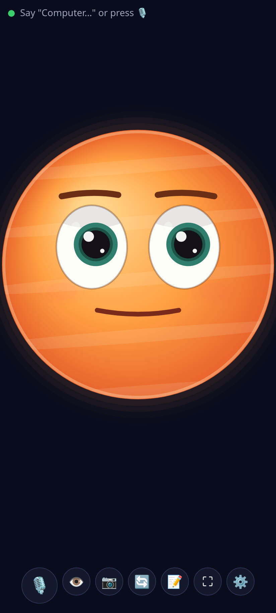

# Desk Buddy

A web version of the desk robot: a full-screen round eye that listens for a wake word, talks back with
Claude, looks through the camera, and keeps notes. It's a static app with no build step, no backend and no CDNs.
It runs on an old Android phone in Chrome as an always-on companion, or in a laptop browser.

## Run it

The microphone and camera only work on **HTTPS** or **localhost**.

- On a laptop: `python3 -m http.server 8000` in this folder, then open <http://localhost:8000>.
- On an Android phone, from the laptop over USB: run the server on the laptop, enable USB debugging on the phone, then
  `adb reverse tcp:8000 tcp:8000` and open `http://localhost:8000` in Chrome on the phone (localhost counts as secure).
- Hosted: any static HTTPS host works (GitHub Pages, Netlify, Cloudflare Pages…). Then use Chrome's menu > *Add to Home screen*
  or *Install app* to get a full-screen icon.

A plain `http://192.168.x.x:8000` address from another device is **not** secure, so Chrome blocks the mic and camera there.

## Use it

1. Tap **Start**. The first tap is needed so the browser allows speech, the mic and the screen wake lock.
2. ⚙️ **Settings**: paste a Claude API key. Use a separate key with a low spend limit. It's saved only in this browser's
   localStorage and sent only to `api.anthropic.com`. **Clear key** removes it.
3. Say **"Jarvis, …"** (the wake word can be changed), or press 🎙️ / Space and just talk.
   For a few seconds after each reply you can follow up without the wake word.
   - "Jarvis, take a note: buy milk" · "Jarvis, read my notes" (📝 to view, delete, or export as .md)
   - "Jarvis, what is this?" / "look at this" / press 👁️: sends one camera frame to Claude
   - "Jarvis, go to sleep" · "Jarvis, start over" (forget the conversation)
4. Tap the eye to poke it, stroke it to pet it, and tap it (or press Esc) while it's talking to stop it.

Captions show **You:** (right, blue) for what it heard from you and **Buddy:** (left; the name is a setting) for its replies.

## Faces

Settings → Screen → **Face**: **Round ball** (new, default) or **Classic eye** (the RoundEye firmware look).
Both share the same face interface (moods, gaze, blinks, yawns, sleep with drifting z's, petting, listening ring,
thinking indicator), so the rest of the app doesn't care which is shown. Canvas 2D at about 30 fps, devicePixelRatio capped at 2.

## Listening

Settings → **Listening mode**:

- **Always** (default): one microphone stream stays open the whole time and a small voice-activity detector
  (`js/vad.js`: loudness vs. an adaptive background-noise level, 250 ms minimum, 700 ms hangover) watches it.
  Speech recognition starts only when it hears a voice, at most once every 2 s, and ends by itself after you
  stop talking. Nothing restarts it in a loop.
- **Tap to talk only**: recognition starts only when you press 🎙️ / Space. No sounds otherwise.
- **Off**: the microphone is never used.

While Buddy is speaking, and for 800 ms after, the mic is ignored and any running recognition is aborted.
Any transcript where more than half of the words match Buddy's last two replies is dropped as an echo.
To interrupt Buddy, tap the eye or press Esc.

The eye blinks, wanders, glances around, yawns after a while, gets sleepy after the idle time set in settings,
and falls asleep after twice that. It wakes when it hears speech, sees motion (with the camera on), or is tapped.
Moods are neutral, happy, curious, surprised, thinking, sleepy and angry. Claude picks one by starting its reply with a `[mood]` tag.

## Files

| File | What it does |
| --- | --- |
| `index.html`, `styles.css` | Page, controls, settings and notes dialogs |
| `js/store.js` | Settings, API key and notes in localStorage. Default personality |
| `js/face-ball.js` | **Round ball** face (default): an original glowing planet character with two big glossy eyes, brows, blush and a stretchy talking mouth. Extends the eye's behaviour, only redraws |
| `js/eye.js` | Canvas eye: same colours and geometry as the RoundEye firmware. Moods, blink, wander, yawn, sleep, mouth |
| `js/adapters.js` | **STT/TTS adapter interface**: browser engines now (one recognition session per utterance), `LocalServerSTT` / `LocalServerTTS` stubs for later |
| `js/vad.js` | Voice-activity detector on a single always-open mic stream; gates when recognition starts |
| `js/camera.js` | getUserMedia, front/back, JPEG grab, 40×30 frame-diff motion detection |
| `js/brain.js` | Anthropic Messages API from the browser, rolling memory, `save_note` / `list_notes` tools |
| `js/app.js` | Listening modes, mute while speaking, echo filter, wake word, push-to-talk, intents, idle behaviour, wake lock, fullscreen |
| `manifest.webmanifest`, `sw.js`, `icons/` | Installable PWA. The service worker caches only the app's own files, never API calls |

## Model

The default is `claude-sonnet-5-5` with `effort: "low"` for quick spoken replies. `claude-haiku-5-5` is faster and cheaper.
Both IDs were checked against Anthropic's models overview on 25 Oct 2026. For older models that don't accept the
effort parameter, pick "Don't send" under Effort.

## Later: local speech server

`js/adapters.js` documents the planned protocol: `POST {url}/stt` with audio → `{text}` (faster-whisper),
and `POST {url}/tts` with `{text, voice}` → `audio/wav` (Kokoro). The settings show the engine choices and the URL field disabled until that exists.

## Known limitations

- **Chrome speech recognition sends audio to Google's servers** and needs internet.
- **Android plays a sound every time Chrome starts speech recognition**, and a web page can't turn that off. In
  "Always" mode that's one sound each time you start talking (and also for other voices or a TV nearby). "Tap to talk only"
  avoids it except when you tap. The planned local Whisper server removes it entirely.
- Recognition can't be handed audio from before it started, so on Android the first syllable can be lost. The wake
  word is matched loosely at the start of a sentence ("arvis" counts as "Jarvis"), and saying "Hey Jarvis" helps.
  Desktop Chrome 135+ is given a 0.5 s delayed copy of the mic instead, so nothing is lost there.
- Because the mic is ignored while Buddy talks, you can't interrupt it by voice. Tap the eye instead.
- Echo cancellation in the browser is imperfect, which is why the mute and echo filter exist.
- iOS/Safari isn't tested. Speech recognition there depends on Siri/Dictation, continuous listening is unreliable,
  there's no Fullscreen API on iPhone, and the wake lock needs a recent iOS.
- Chrome may pause the mic and camera when the screen turns off or the tab is in the background. Keep the app in front with the wake lock on.
- The API key lives in the browser. Anyone with the device, or any script running on the same origin, could read it.
  Host it on its own origin and use a spend-limited key.
