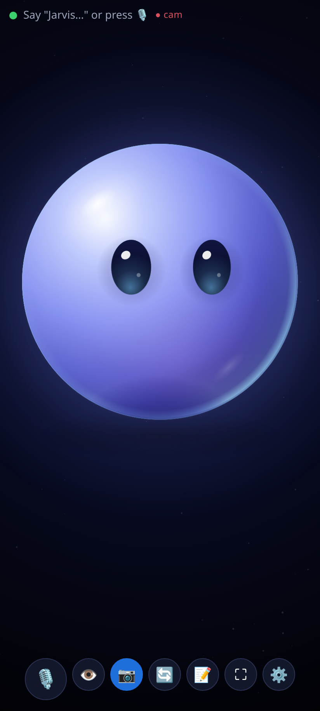
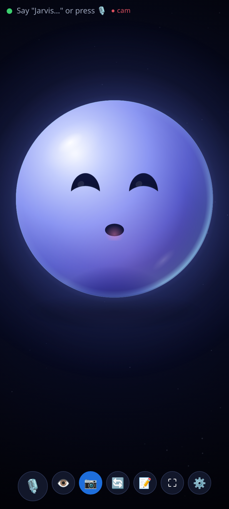
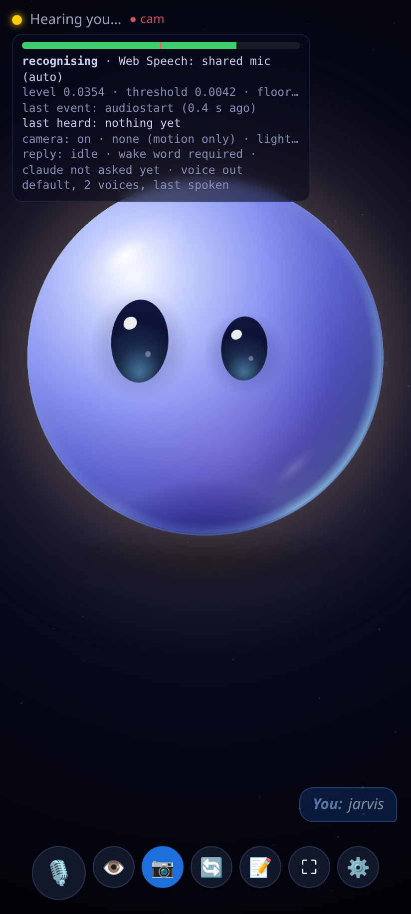

# Desk Buddy

A web version of the desk robot: a full-screen glowing sphere face that listens for a wake word, talks back with
Claude, reacts to what its camera sees, and keeps notes. It's a static app with no build step, no backend and no CDNs.
It runs on an old Android phone in Chrome as an always-on companion, or in a laptop browser.

## Run it

The microphone and camera only work on **HTTPS** or **localhost**.

- On a laptop: `python3 -m http.server 8000` in this folder, then open <http://localhost:8000>.
- On an Android phone, from the laptop over USB: run the server on the laptop, enable USB debugging on the phone, then
  `adb reverse tcp:8000 tcp:8000` and open `http://localhost:8000` in Chrome on the phone (localhost counts as secure).
- Hosted: any static HTTPS host works (GitHub Pages, Netlify, Cloudflare Pages…). Then use Chrome's menu > *Add to Home screen*
  or *Install app* to get a full-screen icon.

A plain `http://192.168.x.x:8000` address from another device is **not** secure, so Chrome blocks the mic and camera there.

## Use it

1. Tap **Start**. The first tap is needed so the browser allows speech, the mic, the camera and the screen wake lock.
2. ⚙️ **Settings**: paste a Claude API key. Use a separate key with a low spend limit. It's saved only in this browser's
   localStorage and sent only to `api.anthropic.com`. **Clear key** removes it.
3. Say **"Jarvis, …"** (the wake word can be changed), or press 🎙️ / Space and just talk.
   For a few seconds after each reply you can follow up without the wake word.
   - "Jarvis, take a note: buy milk" · "Jarvis, read my notes" (📝 to view, delete, or export as .md)
   - "Jarvis, what is this?" / "look at this" / press 👁️: sends one camera frame to Claude
   - "Jarvis, go to sleep" · "Jarvis, start over" (forget the conversation)
4. Tap the eye to poke it, stroke it to pet it, and tap it (or press Esc) while it's talking to stop it.

Captions show **You:** (right, blue) for what it heard from you and **Buddy:** (left; the name is a setting) for its replies.

## Faces

Settings → Screen → **Face**: **Sphere** (default) or **Classic eye** (the RoundEye firmware look).
Both share the same face interface (moods, gaze, blinks, yawns, sleep, petting, listening glow, thinking),
so the rest of the app doesn't care which is shown.

The Sphere is an original design: a softly lit orb (key light with a soft terminator, cool rim light, warm
subsurface glow, glossy specular, occlusion and a bloom halo) on a deep-space background, with two large clean
eyes whose highlights move with the gaze, and a small mouth that only appears while talking or smiling.
Moods change the eyes: happy = crescents, surprised = wide, sleepy = lids, curious = one eye bigger,
thinking = eyes up and to the side, angry = slanted lids. Motion is spring-based: saccades overshoot a little,
blinks have anticipation, it floats and breathes, the face turns on the sphere's surface with foreshortening,
and it squishes when tapped. Canvas 2D with cached offscreen layers, 30 to 60 fps, devicePixelRatio capped at 2.

| Neutral | Happy (talking) | Sleepy |
| --- | --- | --- |
|  |  |  |

## Camera (on by default)

Settings → Camera → **Camera on at start** (front camera by default; back, or off until you press 👁️).
A small red **● cam** next to the status shows when it's on, and it pauses whenever the page is hidden.
If you refuse the camera permission, Buddy says so once and carries on with voice only.

The face reacts to what it sees. All of this runs on the device from a 160×120 picture at about 8 frames a second
(2 a second while asleep), and **nothing is sent to Claude automatically**:

- the eyes follow movement, or a face where the browser has the on-device `FaceDetector` (not every browser does; without it, motion only);
- when someone comes back after two minutes or more it looks happy, with an optional spoken "Hi!" at most every N minutes (off by default);
- when the room goes dark it gets sleepy and falls asleep 20 s later; when the lights come back on it wakes up;
- a big sudden movement makes it look surprised.

**Curious glances** (Settings → Camera, off by default): every N minutes while someone is in view, one 320 px picture
goes to Claude with no conversation history, and Buddy shows or says a short remark. Roughly 100 input tokens for the
picture (Anthropic's rule of thumb is width × height ÷ 750) plus the personality prompt and a reply capped at 300 output tokens (thinking included),
so about the cost of one short question each time. These are estimates; check usage in the Claude Console.

## Listening

Settings → **Listening mode**:

- **Always** (default): one microphone stream stays open and a small voice-activity detector (`js/vad.js`) watches it.
  Recognition starts only when it hears a voice and ends by itself after you stop talking. Nothing restarts it in a loop.
- **Tap to talk only**: recognition starts only when you press 🎙️ / Space.
- **Off**: the microphone is never used.

Settings → Speech engines → **Speech to text**:

- **Auto** (default): Web Speech, with the fallbacks below. On-device Whisper if the browser has no Web Speech.
- **Web Speech only**: Chrome's recogniser (Google's servers). On Android it beeps each time it starts (a page can't turn that off).
- **On-device Whisper (no beeps, private)**: Whisper tiny.en (default, about 40 MB) or base.en (about 75 MB) running in
  the page with transformers.js (WebGPU if available, otherwise WebAssembly). The model downloads once from Hugging Face
  with a progress display, then stays cached. The voice detector records each utterance (with 0.9 s of pre-roll, so the
  start of "Jarvis" isn't lost) and a worker transcribes it. No SpeechRecognition, no beep, and audio never leaves the device.
  On the test machine (WebAssembly, one thread) tiny.en took about 1.7 to 2.5 s for a 3 s utterance; a phone will be slower.

**Web Speech fallbacks.** Some Android phones won't let recognition hear the mic while the voice detector holds it.
In Auto, Buddy notices (a mic error, no audio reaching recognition within 3.5 s twice, or nothing recognised while you
were clearly talking) and switches strategy: *shared* → *release* (close the detector's mic while recognising, then reopen it)
→ *continuous* (plain always-on recognition, which beeps; it says so). What worked is remembered on the device.
Settings → Speech engines → **Web Speech mic strategy** forces one.

**Diagnostics strip** (Settings → Listening, on by default): a live mic-level bar with the trigger threshold, the state
(idle / voice / recognising / muted while speaking / cooldown / transcribing), the engine and strategy, the last
recognition event or error, the last transcript and the camera status.

**Mic sensitivity** (1 to 10) and **Calibrate mic** (2 s of quiet, then 3 s of talking) set the trigger level.
**Mic processing** chooses the browser's processing: balanced (echo cancelling + auto gain, default), full (also noise
suppression) or raw (echo cancelling only).

While Buddy is speaking, and for 800 ms after, the mic is ignored and any running recognition or transcription is dropped.
Within 5 s of Buddy speaking, any transcript where more than half of the words match Buddy's last two replies is dropped
as an echo. After that, only a near-copy (85% or more) is dropped, so a follow-up that reuses Buddy's words still gets through.

**Wake word.** "Require the wake word" is Yes by default. Conversation mode answers everything while someone is on camera
(it still needs the wake word when the camera is off). No answers everything it hears. After every reply there's a follow-up
window (8 s by default) when no wake word is needed. The match is forgiving at the start of what you say, or after
"hey"/"ok"/"um": Android often loses the first syllable, and Whisper-tiny mishears names. So "Jarvis," "Jervis",
"Charvis", "arvis", "service", "travis" and "jar vis" all count, but "the service was slow" doesn't. When you're heard
without the wake word, the words show faintly with a hint: say the wake word first, or turn it off.

### If it listens but doesn't answer

Look at the `reply:` line in the diagnostics strip:
- **wake word required**, with a faint "You:" caption and the hint: the wake word wasn't recognised. Start with "Hey Jarvis",
  or set "Require the wake word" to Conversation mode or No.
- **claude …** shows the last call: `ok 1.8 s`, or the error (`auth 401`, `rate 429`, `model 404`, `network`, …). Every error is
  also spoken and captioned. If the model rejects the effort setting, Buddy retries once without it and stops sending it.
- **voice out …** shows the voice used, how many voices the browser has loaded, and the last speech error. On Android Chrome:
  - Speech is unlocked by a silent utterance in the Start tap.
  - A voice saved on another device falls back to the default.
  - Speech that never reports its end times out (about 4 s plus 1 s per 12 characters), so Buddy can't stay "speaking"
    with the mic muted.
  - The caption always shows, even when the voice fails.
- A watchdog sends any stuck "thinking"/"speaking" state back to idle.
- If Android ends a recognition session with only a partial (interim) result, that result is used as the transcript.
To interrupt Buddy, tap the face or press Esc.

The face blinks, wanders, yawns after a while, gets sleepy after the idle time set in settings, and falls asleep after
twice that. It wakes when it hears speech, sees movement or the lights come on, or is tapped.
Claude picks a mood by starting its reply with a `[mood]` tag.

## Files

| File | What it does |
| --- | --- |
| `index.html`, `styles.css` | Page, controls, settings and notes dialogs |
| `js/store.js` | Settings, API key and notes in localStorage. Default personality |
| `js/face-sphere.js` | **Sphere** face (default). Extends the eye's behaviour with springs and cached lighting layers; only redraws |
| `js/eye.js` | Canvas eye: same colours and geometry as the RoundEye firmware. Moods, blink, wander, yawn, sleep, mouth |
| `js/adapters.js` | **STT/TTS adapter interface**: Web Speech (one session per utterance, or continuous), `LocalServerSTT` / `LocalServerTTS` stubs |
| `js/whisper.js`, `js/whisper-worker.js` | On-device Whisper engine (same interface) and its module worker |
| `js/vendor/transformers/` | transformers.js 4.3.1 and its ONNX Runtime WebAssembly files, self-hosted (licences included) |
| `js/vad.js`, `js/capture-worklet.js` | Voice-activity detector on one always-open mic stream, sensitivity and calibration; 16 kHz capture with pre-roll for Whisper |
| `js/camera.js` | getUserMedia, front/back, JPEG grab, on-device perception: motion, faces, presence, light, startle |
| `js/brain.js` | Anthropic Messages API from the browser, rolling memory, `save_note` / `list_notes` tools |
| `js/app.js` | Listening modes, engine fallbacks, diagnostics strip, mute while speaking, echo filter, wake word, push-to-talk, intents, camera reactions, glances, idle behaviour |
| `manifest.webmanifest`, `sw.js`, `icons/` | Installable PWA. The service worker caches only the app's own files, never API calls |

## Model

The default is `claude-sonnet-5-5` with `effort: "low"` for quick spoken replies. `claude-haiku-5-5` is faster and cheaper.
Both IDs were checked against Anthropic's models overview on 25 Oct 2026. For older models that don't accept the
effort parameter, pick "Don't send" under Effort.

## Later: local speech server

`js/adapters.js` documents the planned protocol: `POST {url}/stt` with audio → `{text}` (faster-whisper),
and `POST {url}/tts` with `{text, voice}` → `audio/wav` (Kokoro). On-device Whisper now covers speech-to-text without a server; the server would still help on slow phones and for better voices.

## Known limitations

- **Web Speech sends audio to Google's servers** and needs internet. On-device Whisper doesn't.
- **Android plays a sound every time Chrome starts Web Speech recognition**, and a web page can't turn that off.
  On-device Whisper avoids it entirely.
- On-device Whisper needs the model download (40 or 75 MB) the first time, and transcribes after you stop talking, so
  replies start a second or more later than with Web Speech. On an older phone, tiny.en is the one to use.
- GitHub Pages can't send the headers for multi-threaded WebAssembly, so Whisper runs on one CPU thread unless WebGPU is available.
- Web Speech can't be handed audio from before it started, so on Android the first syllable can be lost. The wake
  word is matched loosely at the start of a sentence ("arvis" counts as "Jarvis"), and saying "Hey Jarvis" helps.
  Desktop Chrome 135+ is given a 0.5 s delayed copy of the mic instead, so nothing is lost there.
- Because the mic is ignored while Buddy talks, you can't interrupt it by voice. Tap the eye instead.
- Echo cancellation in the browser is imperfect, which is why the mute and echo filter exist.
- iOS/Safari isn't tested. Speech recognition there depends on Siri/Dictation, continuous listening is unreliable,
  there's no Fullscreen API on iPhone, and the wake lock needs a recent iOS.
- The camera's reactions are simple on-device heuristics (frame differences and brightness), tuned on a test machine, not a real room.
- Chrome may pause the mic and camera when the screen turns off or the tab is in the background. Keep the app in front with the wake lock on.
- The API key lives in the browser. Anyone with the device, or any script running on the same origin, could read it.
  Host it on its own origin and use a spend-limited key.
